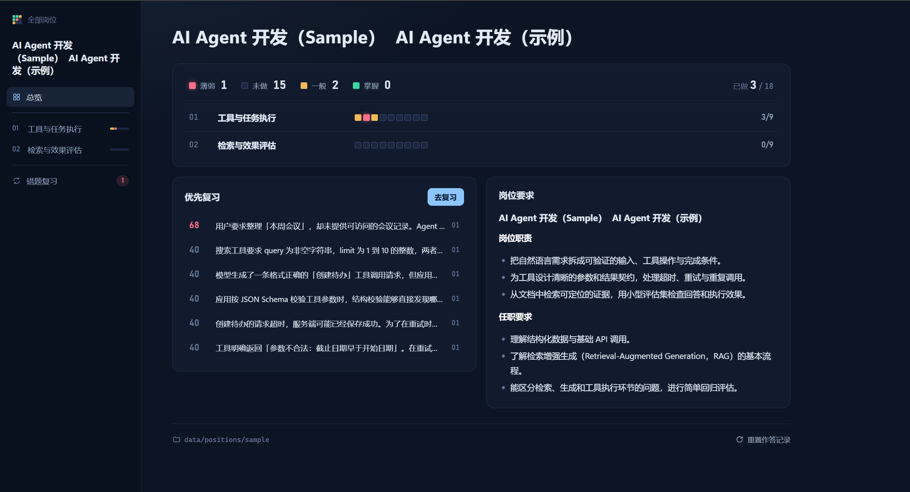
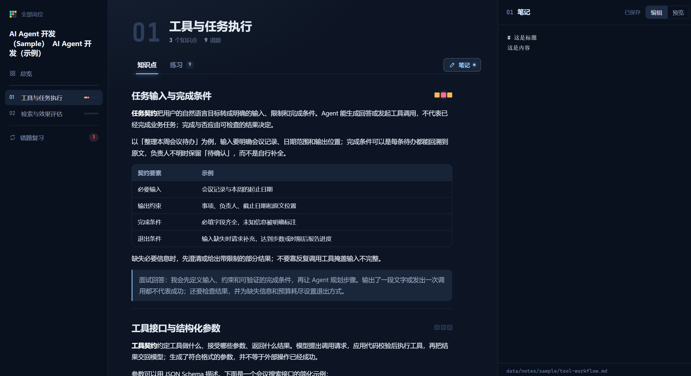
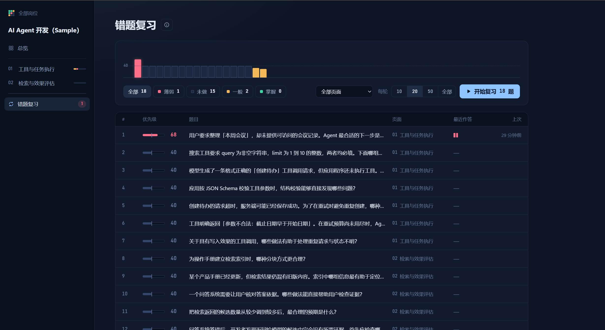

# 面试准备 · Interview Prep

<details>
<summary><b>English</b></summary>

### What it offers

A local interview-prep website. It runs on your own computer with no account or internet connection, and everything it stores is a plain file in this folder. The interface is in Chinese.

- **Knowledge pages**: each role is split into pages of knowledge points, with tables, code highlighting and formulas.
- **Quizzes**: every page has multiple-choice questions covering all of its points, and every answer is recorded. Choose “不会” (I don't know) to record an incorrect answer and avoid lucky guesses inflating your mastery.
- **Mistake review** (错题复习): all questions ranked by recent error rate. Recent and repeated mistakes come first, unanswered questions sit in the middle, and questions you always get right go last. The ⓘ button on the review page shows the formula.
- **Notes** (笔记): a Markdown notes panel on every page, saved as `.md` files you can also open in any editor.

### Start

1. Install Python 3.8 or later (on Windows, tick "Add python.exe to PATH").
2. Double-click `start.bat`, or run `python server.py` (`python3` on macOS/Linux). Your browser opens http://127.0.0.1:8765.
3. Close the console window to stop.

### Add a role with an AI agent

`AGENTS.md` guides a coding agent through turning a job description into knowledge points and questions: topic planning, overlap checks, file formats, question quality and validation. Ask your coding agent to read it first, then provide your own job description.

1. Open this folder in your agent and start a new session.
2. Send the job description, for example:

   ```text
   Follow AGENTS.md and add this role:
   (paste the job description: title, company, responsibilities, requirements)
   ```

   You can also mention the level you're interviewing for, the areas to focus on, or that the interview is in English.
3. The agent compares the role with the ones already here, and overlapping roles are not duplicated. If *LLM Security* exists and you add *AI Agent Security*, it extends the existing role instead of creating a new one.
4. Refresh the browser to see the new pages.

### Your data

| Folder | Contents |
| --- | --- |
| `data/positions/` | Roles, pages, knowledge points and questions (format described in `AGENTS.md`) |
| `data/records/` | Your answers, one line per answer |
| `data/notes/` | Your notes, one `.md` file per page; older versions in `_history/` |

To back up, copy `data/`. The 重置作答记录 (reset answers) link at the bottom of a role's overview moves old records to `data/records/archive/` instead of deleting them.

Only `data/positions/sample/` is included in Git. Other role folders, all answer history and all notes are excluded by `.gitignore`, so they stay local when you commit or push. Generate personal content in a new role folder rather than replacing Sample with private information. Back up your local data separately.

### Keys

| Key | Action |
| --- | --- |
| `A`–`H` or `1`–`8` | Choose an option |
| `0` | Choose “不会” (I don't know) |
| `Enter` | Submit, then go to the next question |
| `←` `→` | Previous / next question |
| `Ctrl+S` | Save notes now |
| `Esc` twice | Close the notes panel |

### Commands

```text
python server.py --check      Check the question bank for format problems
python server.py --outline    List every role, page and knowledge point
python server.py --port 9000  Use a different port
```

</details>

<details>
<summary><b>简体中文</b></summary>

### 网站提供什么

一个在本机运行的面试复习网站：不需要账号，不需要联网，存下来的所有东西都是这个文件夹里的普通文件。

- **知识点**：每个岗位分成若干页面，每页若干知识点，支持表格、代码高亮和公式。
- **选择题**：每页的题目覆盖本页全部知识点，每次作答都会记录。选择「不会」按答错记录，避免蒙对影响掌握度。
- **错题复习**：全部题目按近期错误率排序。最近错的、反复错的排在最前，没做过的在中间，一直答对的在最后。复习页的 ⓘ 按钮里有排序公式。
- **笔记**：每页一个 Markdown 笔记面板，自动保存成 `.md` 文件，也可以用任何编辑器打开。

### 启动

1. 安装 Python 3.8 或更高版本（Windows 上勾选 “Add python.exe to PATH”）。
2. 双击 `start.bat`，或运行 `python server.py`（macOS / Linux 用 `python3`）。浏览器会打开 http://127.0.0.1:8765 。
3. 关闭控制台窗口即停止。

### 让 AI agent 生成岗位题库

`AGENTS.md` 可以指导 coding agent 根据岗位信息生成知识点和题目，包含主题规划、重叠判断、文件格式、出题标准和校验流程。让 coding agent 先读取这个文件，再提供你自己的 JD 即可。

1. 用 agent 打开这个文件夹，新开一个会话。
2. 把岗位信息发给它，例如：

   ```text
   按 AGENTS.md 把这个岗位加入题库：
   （粘贴 JD：岗位名、公司、职责、任职要求）
   ```

   还可以补充面试级别、想侧重的方向，或者面试用英文。
3. agent 会先和已有岗位比对，重叠的不会重复建一份。比如已有 LLM Security，再加 AI Agent Security 时，它会扩展原来的岗位，而不是新建一个。
4. 完成后刷新浏览器即可看到新页面。

### 数据在哪

| 文件夹 | 内容 |
| --- | --- |
| `data/positions/` | 岗位、页面、知识点、题目（格式见 `AGENTS.md`） |
| `data/records/` | 作答记录，每答一题一行 |
| `data/notes/` | 笔记，每页一个 `.md` 文件；旧版本在 `_history/` |

备份就复制整个 `data/`。岗位总览页底部的「重置作答记录」会把旧记录移到 `data/records/archive/`，不会删除。

Git 只收录 `data/positions/sample/`。其他岗位目录、全部作答记录和笔记都通过 `.gitignore` 排除，提交和推送时仍留在本地。个人内容请写到新的岗位目录，不要用私人资料覆盖 Sample；本地数据需单独备份。

### 快捷键

| 按键 | 作用 |
| --- | --- |
| `A`–`H` 或 `1`–`8` | 选择选项 |
| `0` | 选择「不会」 |
| `Enter` | 提交，再按一次进入下一题 |
| `←` `→` | 上一题 / 下一题 |
| `Ctrl+S` | 立即保存笔记 |
| 按两次 `Esc` | 关闭笔记面板 |

### 命令

```text
python server.py --check      检查题库格式
python server.py --outline    列出所有岗位、页面和知识点
python server.py --port 9000  换一个端口
```

</details>

## 界面预览 / Screenshots

### 岗位总览



### 知识点与笔记



### 错题复习


